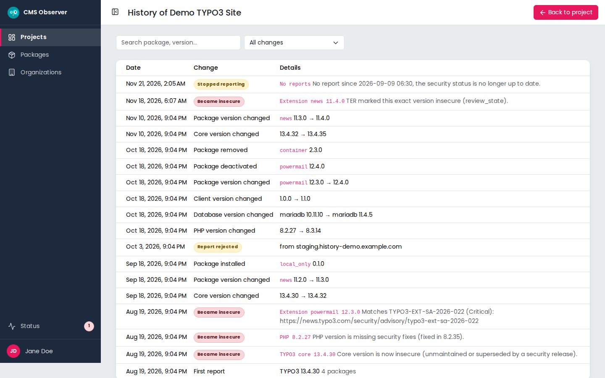

# Clients

Sites push their state to the Observer; the Observer never connects to a
site. Available clients:

- TYPO3: [cms-observer-client-typo3](https://github.com/portrino/cms-observer-client-typo3)
- WordPress: [cms-observer-client-wordpress](https://github.com/portrino/cms-observer-client-wordpress)

## Report API

```
POST /api/v1/sites/report
Authorization: Bearer <token>
Content-Type: application/json
```

```json
{
  "coreVersion": "13.4.20",
  "phpVersion": "8.3.14",
  "dbVersion": "10.11.19-MariaDB",
  "dbPlatform": "mariadb",
  "clientVersion": "1.1.0",
  "applicationContext": "Production",
  "domains": ["www.example.com"],
  "packages": [
    {"name": "news", "type": "extension", "title": "News", "version": "12.3.1", "active": true, "composerName": "georgringer/news"}
  ]
}
```

| Field | Required | Meaning |
|---|---|---|
| `coreVersion`, `phpVersion`, `dbVersion` | yes | versions as the system reports them; `dbVersion` may carry a vendor suffix |
| `dbPlatform` | no | `mariadb`, `mysql` or `postgresql`; without it the platform is guessed from `dbVersion` |
| `clientVersion`, `applicationContext` | no | shown on the project page, e.g. `Production` or `staging` |
| `domains` | no | all hosts of the instance, lowercase, without scheme and port, see [domain check](#domain-check) |
| `packages` | no | all installed packages. `type` is `extension` (TYPO3), `plugin` or `theme` (WordPress), without it the CMS's default (`extension`, `plugin`); entries of an unknown type are left out. `name` is the TYPO3 extension key or the wordpress.org slug (for a theme its directory). The list is complete for every type: a WordPress site without themes in it has none. Without the field the packages stay as they are |
| `extensions` | no | sent by older clients instead of `packages`, still accepted: the packages of the default type only, so WordPress themes stay as they are |

The token belongs to one project and is shown once when the project is
created or a new one is generated (see [Projects](configuration.md#projects)). HTTPS is required.

| Response | Meaning |
|---|---|
| `202` | accepted |
| `401` | unknown or missing token |
| `409` | rejected by the domain check, the JSON `message` says why |
| `422` | invalid payload, e.g. a missing required field |

The API stays compatible: new fields are added as optional, existing ones are
never renamed or removed, so sites can update their client late.

## Compatibility

Update the Observer before the clients. A client release that needs a
newer Observer names the minimum version in its changelog; an older
Observer ignores the new fields, so that data is missing until it is
updated (see [ADR-0002](adr/0002-no-observer-version-check-in-clients.md)).

## Domain check

Production and staging of a site often share a database dump, and with it a
scheduler task or the token. To keep a staging copy from overwriting the
production data, a report whose `domains` don't contain the host of the
project's URL is rejected with `409`. The project page then shows when and
from which domains.

Reports without `domains` (older clients) or with an empty list (e.g. a
TYPO3 site whose site configurations only have relative bases) are accepted
unchecked. The best protection is still a token per environment, set through
an environment variable instead of the database.

## What a report changes

Every report is compared with the stored state. Differences end up in the
project's history: core, PHP, database and client version changes and
installed, updated, removed, activated and deactivated packages. Packages no
longer reported are removed from the project.



## Supporting another CMS

New CMS are welcome, as pull requests or as an issue to discuss them first.
Supporting one takes two parts:

1. **A client** in its own repository that sends the report above, e.g. once
   a day by the CMS's scheduler or cron. Keep the payload small and stable,
   and send `domains` so the domain check works. The TYPO3 and WordPress
   clients are good templates.
2. **The Observer side** in this repository: a new `CmsType` and
   `PackageType`, a sync for the CMS's core releases (rated by
   `SiteCoreVersionEvaluator`) and, where a public source exists, for its
   package versions and vulnerabilities. PHP and the database are covered
   already.
