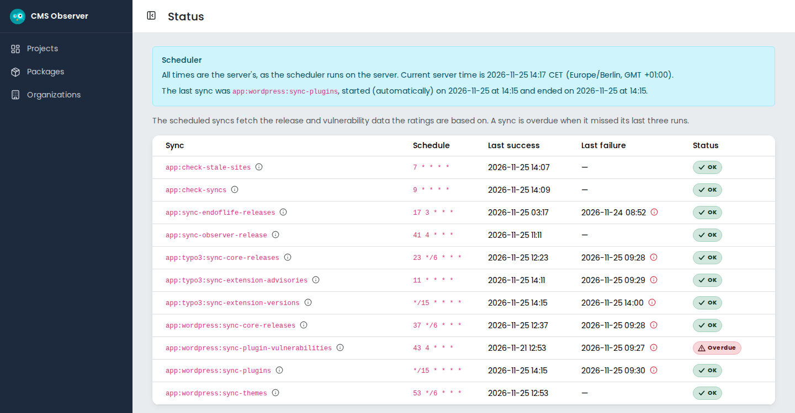

# Configuration

All settings are environment variables, see
[installation](installation.md#setup).

## Email

Every user of the dashboard gets the security mails. One sync run or report
collects all new findings, e.g. a new TYPO3 security release affecting twenty
sites, into a single mail. A finding is only mailed once: when a core, PHP or
database version or a package becomes insecure, not on every later check.

A project that sends no report for 2 days is mailed too, once per outage: its
security status is no longer up to date, e.g. because the client or its cron
job stopped working, or the token was replaced.

The mails link to the projects, so `DEFAULT_URI` must be the Observer's
public URL.

Each user gets the mails in the language chosen in the profile. With
"Automatic" they are English, as there is no browser to ask when mailing.
A test mail is in the language of whoever sends it.

To check the mail setup, send a test mail from the **Status** page or with
`php bin/console app:mail:test <address>`. Both show the sender and the
transport in use and, if sending fails, the mail server's error.

## Scheduled syncs

The worker started by the [cron job](installation.md#cron-job) runs these
syncs. Each can also be run by hand, e.g. right after the installation:

| Command | Schedule | Fetches |
|---|---|---|
| `app:typo3:sync-core-releases` | every 6 hours | TYPO3 releases and their security/support status |
| `app:typo3:sync-extension-advisories` | hourly | TYPO3 extension security advisories |
| `app:typo3:sync-extension-versions` | every 15 minutes | TER versions of the reported extensions, 20 per run |
| `app:wordpress:sync-core-releases` | every 6 hours | WordPress releases and which are insecure |
| `app:wordpress:sync-plugins` | every 15 minutes | wordpress.org versions of the reported plugins, 40 per run |
| `app:wordpress:sync-themes` | every 6 hours | wordpress.org versions of the reported themes |
| `app:wordpress:sync-plugin-vulnerabilities` | daily | the Wordfence vulnerability feed (needs `WORDFENCE_API_KEY`) |
| `app:craft:sync-core-releases` | every 6 hours | Craft CMS releases from Packagist; only once `app:sync-endoflife-releases` and `app:craft:sync-advisories` ran, until then the Craft CMS version of a project stays unknown |
| `app:craft:sync-plugin-versions` | every 6 hours | Packagist versions of the reported Craft plugins |
| `app:craft:sync-advisories` | hourly | Packagist security advisories of Craft CMS and the reported plugins |
| `app:sync-endoflife-releases` | daily | PHP, MariaDB, MySQL, PostgreSQL, TYPO3 and Craft CMS support cycles |
| `app:sync-observer-release` | daily | the latest CMS Observer release on GitHub; a newer one marks the logo, details in its dropdown |
| `app:check-stale-sites` | hourly | nothing; mails projects that stopped sending reports |
| `app:check-syncs` | hourly | nothing; mails syncs that missed their last three runs |

The **Status** page in the sidebar shows when each sync last succeeded and
last failed, with the error. A sync that missed its last three runs is
overdue: the sidebar shows a badge and a mail with the last error goes out,
once per outage. If the worker itself stopped, no mail can go out, only the
badge shows it. The page also shows the server time and warns when the worker
runs in another timezone than the web server.



Wordfence rate-limits strictly, so don't run its sync repeatedly by hand. A
run that hits the limit keeps the last data and counts as failed, so a sync
stuck in the limit shows up as overdue on the status page.

## Users and two-factor authentication

```bash
php bin/console app:user:create <email> <name> <password>   # a new login
php bin/console app:user:reset-2fa <email>                  # e.g. after a lost phone
```

Users set up two-factor authentication (TOTP, with backup codes) in their
profile. The TOTP secrets are encrypted with `TOTP_ENCRYPTION_KEY`; without a
valid key the profile doesn't offer the setup.

A login session ends after 2 hours of inactivity; expired sessions are
removed from the database now and then on a later request. "Remember me" on the login
form keeps a user logged in for 30 days; changing the password or resetting
two-factor authentication logs out every remembered browser.

## Language

The interface is in English and German. Each user picks the language in the
profile; the default "Automatic" follows the browser and falls back to
English. Dates, numbers and prices are formatted for the language, e.g.
`700,00 €` in German and `€700.00` in English.

What the Observer writes and keeps, e.g. the history, is shown in the
reader's language. Texts saved with an upgrade calculation, such as its
prefilled positions, stay in the language of whoever wrote them. The console
commands, logs and the report API are English only.

## Projects

Projects (sites) are created in the dashboard or on the command line:

```bash
php bin/console app:site:create "<name>" <typo3|wordpress> "<site-url>"
```

Both print the site's token once; the client needs it. The token is stored
hashed, so a lost one can't be shown again. Generate a new one in the
project's edit form or with:

```bash
php bin/console app:site:list
php bin/console app:site:regenerate-token <id>
```

The old token stops working immediately. The site URL must be
the URL the site really uses, see the [domain check](clients.md#domain-check).
