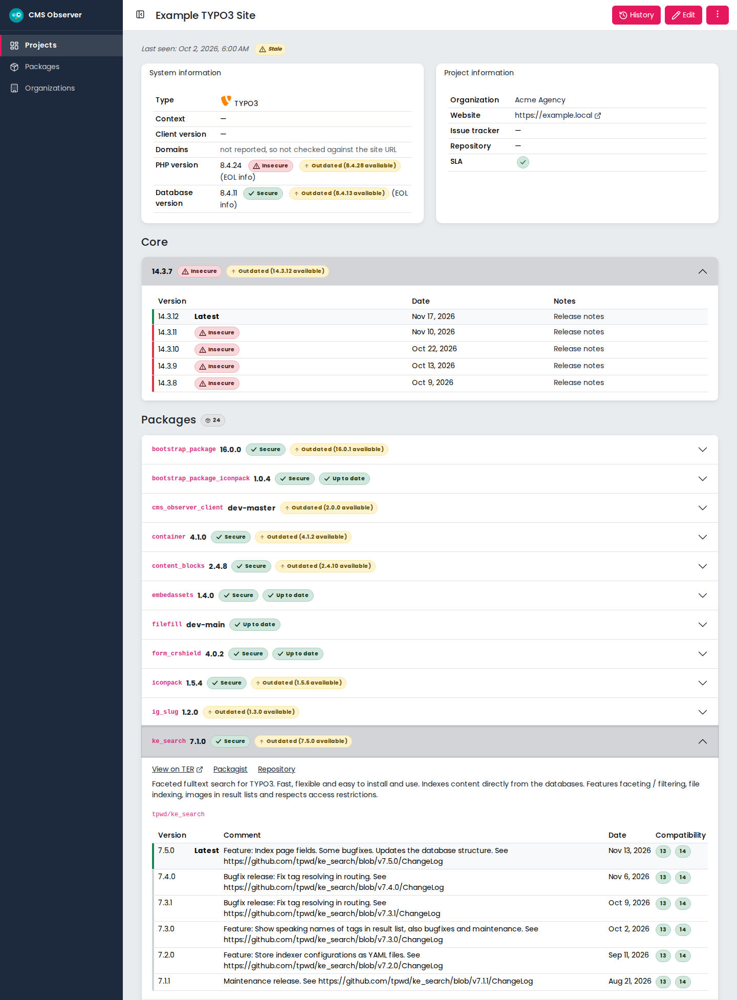
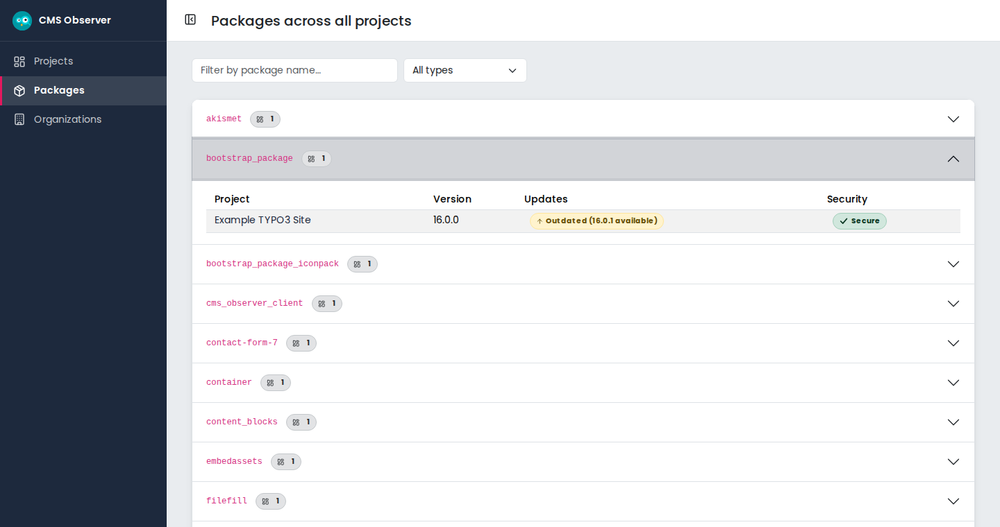

# Data sources

The Observer rates every report against data it syncs from public sources,
see [scheduled syncs](configuration.md#scheduled-syncs). Until a source was
synced at least once, the matching status stays "unknown" (gray), never
"secure".

| What | Source | Insecure when | Outdated when |
|---|---|---|---|
| TYPO3 core | [get.typo3.org](https://get.typo3.org/) | the version is no longer maintained or a newer security release exists | a newer release exists |
| TYPO3 extensions | [TER](https://extensions.typo3.org/) and the [TYPO3 security advisories](https://typo3.org/help/security-advisories) | the TER marks the exact version insecure or an advisory affects it | the TER has a newer version |
| WordPress core | [wordpress.org](https://wordpress.org/download/releases/) | wordpress.org marks the version insecure | a newer release exists |
| WordPress plugins | [Wordfence Intelligence](https://www.wordfence.com/threat-intel/) and [wordpress.org](https://wordpress.org/plugins/) | a Wordfence vulnerability affects the version | wordpress.org has a newer version |
| WordPress themes | [Wordfence Intelligence](https://www.wordfence.com/threat-intel/) and [wordpress.org](https://wordpress.org/themes/) | a Wordfence vulnerability affects the version | wordpress.org has a newer version (unknown for themes not on wordpress.org) |
| Craft CMS core | [Packagist](https://packagist.org/packages/craftcms/cms), its [security advisories](https://packagist.org/packages/craftcms/cms/advisories) and [endoflife.date](https://endoflife.date/craft-cms) | the major is past end of life or an advisory affects the version | a newer release exists in the major |
| PHP | [endoflife.date](https://endoflife.date/php) | the cycle is past end of life or misses a security release | a newer release exists in the cycle |
| MariaDB, MySQL, PostgreSQL | [endoflife.date](https://endoflife.date/) | the cycle is past end of life | a newer release exists in the cycle |

Informational Wordfence entries (without real-world impact) are ignored.
Packages that aren't on the TER or wordpress.org, e.g. a site's own
extensions, stay "unknown".

## How a site is rated

In the project list a row is marked red when the core or a package is
insecure. PHP and the database have an icon of their own and never mark the
row: on shared hosting the site's maintainers often can't change these
versions. The security filter lists such projects separately.

The same icon turns red when a site reports an application context that
doesn't start with `Production`, e.g. `Development` in TYPO3 or the
environment type `staging` or `development` in WordPress: reports only come
from the production URL, where such a context can show error details and
debug output to the public.

A new finding (something that wasn't insecure before) also triggers the
[security mail](configuration.md#email) and an entry in the project's history.
When the core, PHP, database or application context is fine again, the
history records that too, without a mail.

The **Packages** page lists every package across all projects, with the
version each project runs and its update and security status, e.g. to find
all sites affected by a new advisory.

## Licenses

The Wordfence and MITRE data comes with license terms that require their
copyright notices next to the data; the dashboard shows them with every
vulnerability.
