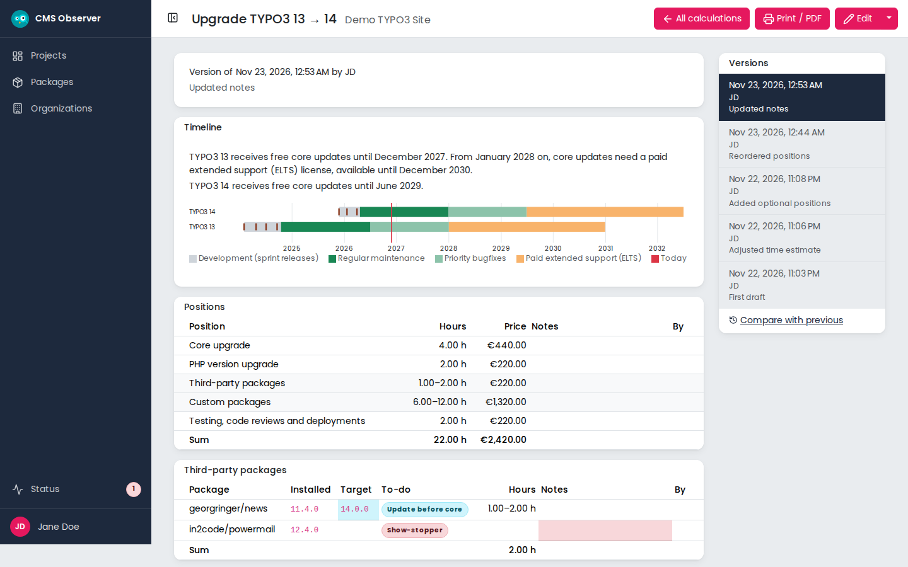

# Upgrade calculations

A calculation estimates the effort and price of a major core upgrade of a
project, e.g. TYPO3 13 → 14. It starts from the project's latest report and
replaces spreadsheets that were passed from developer to developer to
project manager.

Open it from a project's page: **⋮ → Upgrade calculations**, then pick the
target major and **Start**.

## What a calculation contains

- **Positions**: the work of the upgrade, e.g. core upgrade, PHP upgrade,
  testing. "Third-party packages" and "Custom packages" are positions too,
  their hours are the sums of those sections. Positions can be added,
  removed and reordered by dragging; the two package sums can't be removed.
  The prefilled positions are named in the language of whoever starts the
  calculation; the two sums always show in the reader's language.
- **Third-party packages**: packages the Observer has release data for. For
  TYPO3 each extension gets the lowest version for the target major from the
  TER and Packagist and a to-do: compatible, update before the core (a version supports
  both majors, e.g. in the monthly maintenance), update with the core,
  show-stopper (no version for the target yet) or check manually.
  "Replace" and "Remove" are set by hand. WordPress packages are checked
  manually for now.
- **Custom packages**: packages without release data, e.g. a site package,
  and the agency's own packages even when published: their Composer vendor
  is one of the **Agency vendor names on Packagist** in **Settings** (user
  menu), e.g. `portrino`. They are judged by their versions like
  third-party packages, but their upgrade is the agency's work.
- **Optional**: work offered separately, with its own sum.
- **Notes** per row, with a color: green (compatible or simple update),
  yellow (migration or manual changes needed), red (no compatible version
  yet). Notes, the calculation notes in the head and the remarks below the
  totals are written in Markdown.
  For TYPO3 a package row starts with a note and color: 0 hours and green
  when the latest compatible version is installed, red without a version
  for the target major, else the update with what its changelog says. The
  changelog is the TER upload comments of the versions crossed and, with
  `GITHUB_API_TOKEN` set, their commits on GitHub marked "!!!" (ADR-0007);
  a new major of the package is yellow too. Refreshing a calculation
  judges a row anew when its preset changed since, e.g. the package was
  updated or GitHub found breaking commits; what was entered on the other
  rows stays. A row judged anew is highlighted and has to be marked
  **Checked** before the version can be saved; the notes dialog shows its
  notes of the previous version, to merge them, and the hours column what
  it was before.

Efforts are entered as minimum and maximum hours. Prices are calculated with
the maximum; the range is only shown on screen as a hint that a row was hard
to estimate. Project management is added as a share of the hours, rounded up
to whole hours.

For TYPO3 the head shows the support phases of the current and the target
major from get.typo3.org: development with its sprint releases, regular
maintenance, priority bugfixes and paid extended support (ELTS).

## Versions

Every save creates a new version with a timestamp, the name or initials of
whoever saved it and a short note what changed. Versions are never changed
afterwards. A version can be saved as final, e.g. the one sent to the
customer; later versions are still possible.

- **Compare with previous**, below the version list, shows what changed
  between two versions.
- **Edit → Refresh from report** brings the package rows up to the
  project's latest report: installed and target versions and to-dos are
  recalculated, hours, notes and "Replace" or "Remove" decisions are kept,
  packages no longer installed are left out and new ones added. Nothing is
  saved until the result is saved as a new version.
- **Print / PDF** prints the calculation with its changelog, without who does
  which row.

## Hourly rate and project management

Both are part of each version. A new calculation takes them from the
project's previous calculation, or else from the defaults in
**Settings** (user menu). No defaults are set out of the box.
